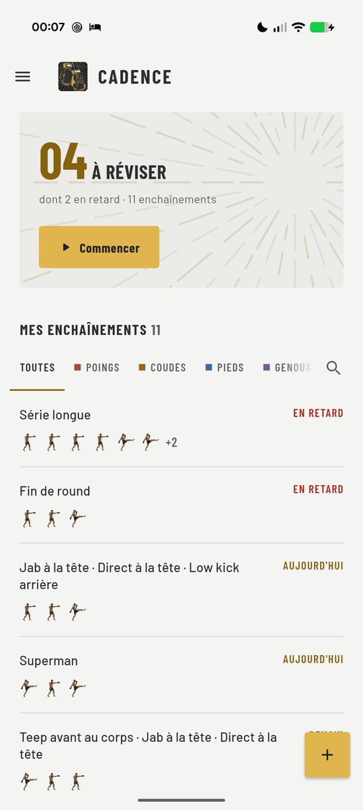
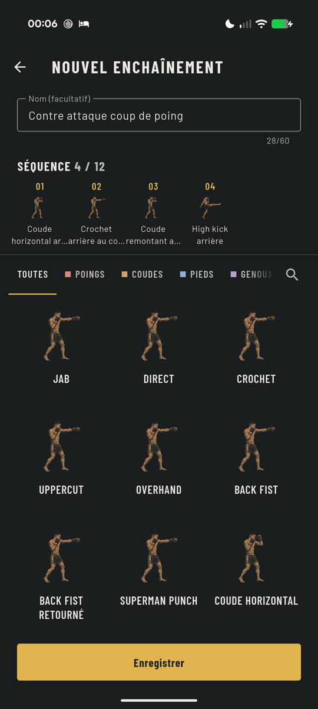
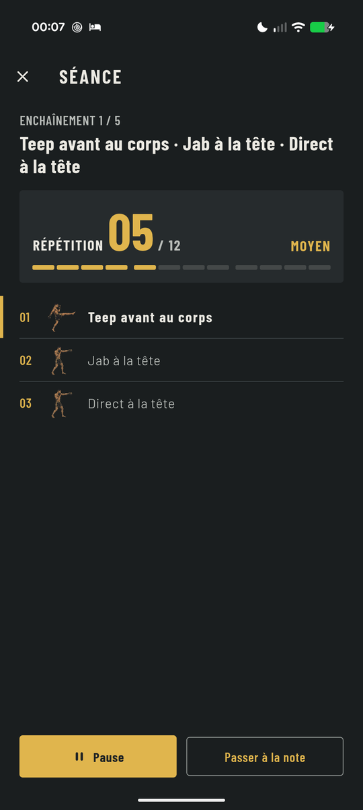
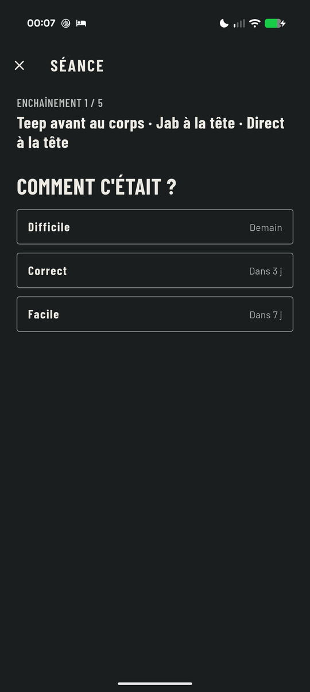
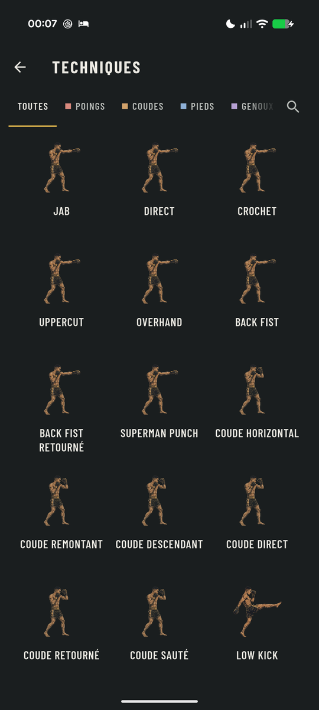
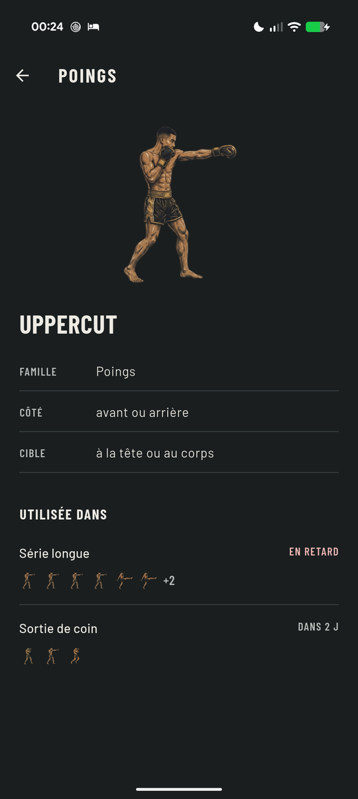
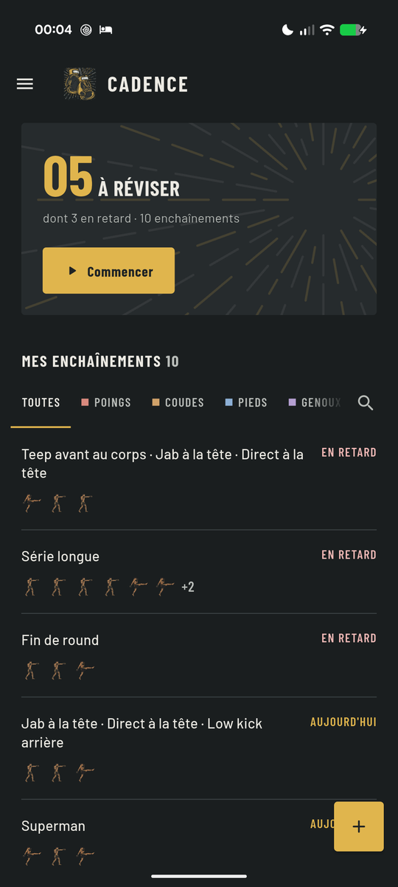

# Cadence

[](https://github.com/Antony35/Cadence/actions/workflows/ci.yml)

Carnet d'enchaînements de sports de combat, sur Android et **hors ligne**.

Après un cours, on note les enchaînements vus en touchant leurs techniques une
à une. Chaque jour, l'application propose ceux qu'il est temps de réviser et
les dicte à voix haute, de plus en plus vite.

<p>
  
  
  
  
  <br>
  
  
  
</p>

Captures prises sur un Pixel 9 Pro XL, avec le jeu de démonstration.

## Installer l'application

Sur le téléphone, ouvrir la dernière
[release](https://github.com/Antony35/Cadence/releases/latest), télécharger
l'APK qui correspond au téléphone, l'ouvrir et accepter l'installation d'une
source inconnue.

| Fichier | Pour quel appareil |
|---|---|
| `cadence-v1.0.0-arm64-v8a.apk` | **Presque tous les téléphones Android** vendus depuis 2017 (processeur 64 bits). À prendre en cas de doute. |
| `cadence-v1.0.0-armeabi-v7a.apk` | Les téléphones plus anciens ou d'entrée de gamme, à processeur 32 bits. |
| `cadence-v1.0.0-x86_64.apk` | Un émulateur Android sur ordinateur, certains Chromebook. |

Si Android refuse le premier (« Application non installée »), le téléphone
a un processeur 32 bits : prendre `armeabi-v7a`. Chaque fichier ne contient
le code que d'une famille de processeurs, d'où trois fichiers de 22 à 26 Mo
plutôt qu'un seul de 64 Mo.

Android 7 ou plus récent. Aucun compte, aucune connexion : l'application
n'a pas l'autorisation d'accéder à Internet.

## À qui s'adresse l'application

À un pratiquant de sport de combat qui suit des cours en club et oublie, d'une
semaine à l'autre, les enchaînements montrés par son professeur.

## Ce qu'elle fait

- **Noter un enchaînement** en touchant ses techniques une à une, avec le
  côté et la cible. Un enchaînement déjà noté est refusé.
- **Réviser au bon moment** : chaque enchaînement revient après 1, 3, 7, 14,
  30 puis 60 jours s'il est su, plus tôt s'il ne l'est pas (boîtes de
  Leitner). La carte « À réviser » dit combien attendent.
- **S'entraîner à la voix** : l'application dicte chaque enchaînement
  12 fois, de plus en plus vite, téléphone posé, écran allumé.
- **Retrouver** un enchaînement par son nom ou ses techniques, filtrer par
  famille, consulter le catalogue des techniques.
- Thème clair ou sombre, taille de la séance réglable.

## Avancement

| Étape | Contenu | État |
|---|---|---|
| 0 | Projet, thème, intégration continue | Fait |
| 1 | Modèles et règles métier | Fait |
| 2 | Base de données SQLite | Fait |
| 3 | Écran principal | Fait |
| 4 | Ajouter et corriger un enchaînement | Fait |
| 5 | Séance de révision vocale | Fait |
| 6 | Réglages et finitions | Fait (une image par famille) |
| 7 | Livraison | Fait |

## Le catalogue des techniques

L'application contient 41 techniques (poings, coudes, pieds, genoux, défenses,
déplacements), nommées selon le glossaire technique de la FFKMDA et l'usage
des clubs français. C'est un **référentiel**, pas une donnée de
démonstration : il est inséré dans la base au premier lancement et ne peut
pas être modifié par l'utilisateur.

## Les données

Une base SQLite locale, six tables : techniques (et leurs côtés et cibles
acceptés), enchaînements, étapes, révisions. La base garantit elle-même son
intégrité : valeurs autorisées (`CHECK`), aucun doublon d'enchaînement
(`UNIQUE`), étapes et révisions supprimées avec leur enchaînement (clés
étrangères en cascade). L'application n'accède à la base que par trois
contrats (`lib/data/repositories.dart`).

Le dossier `drift_schemas/` garde une photo du schéma de chaque version : la
base d'un téléphone pourra être migrée vers la version suivante sans perdre de
données.

## La voix

La voix n'est pas la synthèse vocale du téléphone : chaque annonce a été
enregistrée une fois, d'un trait, avec la synthèse vocale de Gemini, dans
`assets/voice/`. Comme un entraîneur, elle en dit moins quand ça
s'accélère : « Crochet arrière au corps » en lent, « Crochet corps » en
moyen, « Crochet » en rapide (89 annonces longues, 51 courtes). La cible est
toujours annoncée et affichée quand elle a été choisie (« Crochet avant à la
tête »). La voix est
la même sur tous les téléphones et fonctionne hors ligne. Un test vérifie
que chaque annonce, à chaque palier, a son enregistrement. Elle est jouée avec `just_audio`, derrière le contrat
`Speaker` (`lib/platform/clip_speaker.dart`).

## Trois choix justifiés

**Une voix enregistrée plutôt que la synthèse vocale du téléphone.** La
synthèse dépend du téléphone : voix, accent et prononciation des termes
anglais (« Low kick », « Teep ») changent d'un modèle à l'autre, et
certaines sont absentes. Les 140 annonces enregistrées sont les mêmes
partout, hors ligne, et l'annonce peut raccourcir avec la vitesse comme le
ferait un entraîneur. Le prix : 840 Ko d'audio, et toute nouvelle technique
demande ses enregistrements (un test le vérifie).

**drift plutôt que `sqflite`.** `sqflite` exécute du SQL écrit à la main,
sous forme de texte : une faute de colonne n'apparaît qu'à l'exécution.
drift décrit les tables en Dart, vérifie les requêtes à la compilation et
versionne le schéma (`drift_schemas/`) : la V2 (statistiques, techniques
personnelles) pourra migrer la base des téléphones sans perdre de données.

**Des contrats entre les couches, et des faux pour les tests.** Les écrans
ne connaissent que leur contrôleur, les contrôleurs ne connaissent que des
contrats (repositories, voix, horloge, écran allumé). Chaque test d'écran
remplace la base, la voix et l'horloge par des faux : une séance de deux
minutes se teste en temps factice, la voix en panne se simule, et les
règles de révision ne dépendent jamais de la date du jour.

## Dépendances

| Paquet | Pourquoi |
|---|---|
| `freezed`, `freezed_annotation`, `build_runner` | Les objets du modèle sont immuables. `freezed` écrit pour eux `==`, `hashCode`, `copyWith` et `toString` : sans lui, chaque ajout de champ obligerait à modifier ces quatre méthodes à la main, avec le risque d'en oublier une. Le mode « classe classique » est utilisé : la classe reste une classe Dart ordinaire. |
| `drift`, `drift_flutter`, `drift_dev` | ORM sur SQLite. Les tables sont décrites en Dart, drift écrit le SQL. Choisi pour les migrations versionnées (l'application va évoluer) et pour les requêtes vérifiées à la compilation. drift n'est utilisé que dans `lib/data/drift/`. |
| `provider` | Rend les services (repositories, horloge) accessibles à tous les écrans : un écran demande ce qu'il utilise, sans qu'on le lui transmette d'écran en écran (injection de dépendances). Choisi en vue de la V2 (profil et statistiques partagés entre écrans). |
| `intl` | Les dates en français sur la fiche d'un enchaînement (« 24 novembre 2026 »). Déjà présent par `flutter_localizations`. |
| `just_audio` | Joue les annonces enregistrées de la voix, et les accélère un peu sans changer la hauteur de la voix (paliers). Utilisé seulement dans `lib/platform/`, derrière le contrat `Speaker` : les tests utilisent un faux. |
| `wakelock_plus` | Garde l'écran allumé pendant la séance, quand le téléphone est posé. Derrière le contrat `ScreenAwake`, pour la même raison. |
| `shared_preferences` | Garde les deux réglages (thème, taille de séance) entre deux lancements. Seulement dans `lib/data/preferences/`, derrière le contrat `SettingsRepository`. |
| `package_info_plus` | Lit la version de l'APK installé pour « À propos » : toujours celle de `pubspec.yaml`, sans constante à tenir à jour. Lu une fois dans `main.dart`. |
| `flutter_localizations` (SDK) | Les textes de Material en français (infobulles, boutons système). |

Chaque paquet est ajouté à l'étape qui s'en sert.

## Origines

- **Logo et illustrations** : générés par IA (Gemini), puis détourés. Une
  image par famille de techniques.
- **Voix** : générée par la synthèse vocale de Gemini, en une seule fois,
  puis découpée en une phrase par annonce.
- **Polices** : [Barlow et Barlow Condensed](https://github.com/jpt/barlow),
  de Jeremy Tribby, sous licence SIL Open Font License 1.1
  (`assets/fonts/OFL.txt`), embarquées pour fonctionner hors ligne.
- **Vocabulaire** : glossaire technique de la FFKMDA et usage des clubs
  français.

## Limites

- Android seulement, en français seulement.
- Aucun compte ni synchronisation : les données restent sur le téléphone.
  Android peut toutefois les copier dans le compte Google si sa sauvegarde
  est activée (« À propos » le dit).
- Le catalogue des 41 techniques est fixe : on ne peut pas encore ajouter
  les siennes (prévu en V1.2).
- Une illustration par famille, pas encore une par technique.
- Les intervalles de révision sont fixes, sans réglage.
- Le timbre de la voix varie légèrement sur une partie des annonces.
- Pas de publication sur un store : l'APK s'installe à la main.

## Lancer le projet

Prérequis : Flutter 3.47.9 (canal stable) et un téléphone ou un émulateur
Android.

```bash
flutter pub get
dart run build_runner build
flutter run
```

La deuxième commande génère les fichiers `*.freezed.dart` et `*.g.dart`
(voir « Dépendances »). Ils ne sont pas versionnés : on la relance après
chaque modification d'un modèle ou d'une table.

Pour essayer l'application avec dix enchaînements de démonstration
(échéances variées), sur une installation neuve :

```bash
flutter run --dart-define=CADENCE_DEMO=true
```

Sans cette option, l'application démarre vide, comme chez un nouvel
utilisateur.

## Architecture

```
lib/
  models/   objets et règles métier, purs (aucun Flutter, aucune base)
  data/     contrats des repositories ; drift/ : leur implémentation SQLite ;
            preferences/ : les réglages avec shared_preferences
  state/    un contrôleur par écran (ChangeNotifier), les quatre états,
            les contrats de la voix et de l'écran allumé
  platform/ leur implémentation Android (just_audio, wakelock_plus)
  ui/       écrans et composants ; theme/ : toutes les couleurs
```

Un écran ne parle qu'à son contrôleur, qui ne connaît que les contrats de
`data/`. Les services sont créés une fois dans `main.dart`.

## Vérifier la qualité

```bash
dart run build_runner build
flutter analyze
flutter test
```

Ces commandes sont lancées automatiquement à chaque `push` par GitHub
Actions (`.github/workflows/ci.yml`).

## Construire la version finale

L'APK final est signé avec une clé personnelle, hors du dépôt. Gradle la
trouve grâce à `android/key.properties` (jamais versionné) :

```properties
storePassword=…
keyPassword=…
keyAlias=…
storeFile=/chemin/vers/la-cle.jks
```

```bash
flutter build apk --release --split-per-abi
```

Sans ce fichier, la construction s'arrête plutôt que de signer avec la clé
de débogage.

Pousser un tag `v…` lance `.github/workflows/release.yml` : les mêmes
contrôles que la CI, puis la construction des APK signés (clé lue dans les
secrets du dépôt) et leur publication dans une release GitHub. Le tag doit
correspondre à la version de `pubspec.yaml`.

## Documentation

[`docs/CHOIX.md`](docs/CHOIX.md) explique chaque décision, étape par étape.
